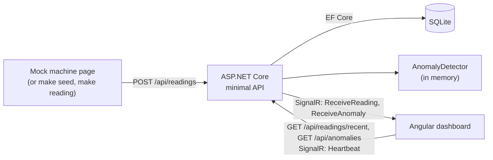
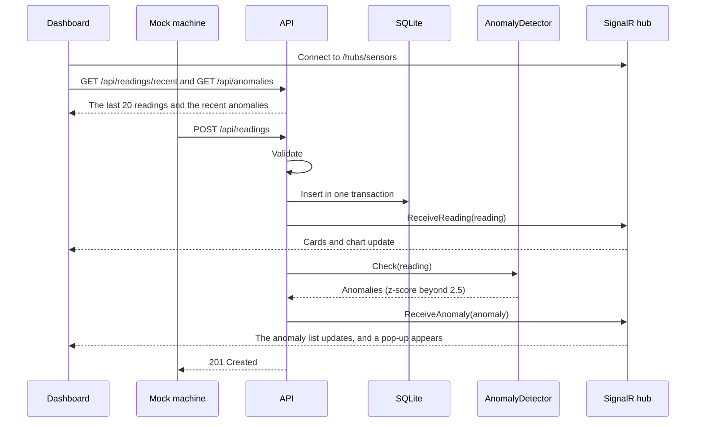
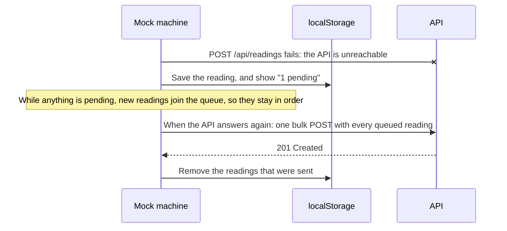

# Greenhouse Guard: system design

A dashboard that shows one greenhouse's temperature, humidity and CO₂ the moment a reading arrives, and flags readings that stand out.

## Components



- **API:** minimal API endpoints that validate and save readings and serve readings and anomalies. `GET /openapi/v1.json` describes them.
- **Anomaly detector:** a z-score check against each sensor's last 20 values, kept in memory.
- **Database:** SQLite through EF Core. Migrations create it when the API starts.
- **Real-time hub:** SignalR at `/hubs/sensors` pushes every reading and anomaly to every open dashboard.
- **Dashboard:** Angular with signals. It shows LIVE or OFFLINE, how long ago the last reading arrived, three colour-coded cards, a chart of the last 20 temperatures, the last 10 anomalies and a pop-up for each new one.
- **Mock machine:** an admin page, `/admin/mock-machine-reading`, that plays a sensor. When the API is unreachable, it keeps its readings in localStorage and sends them later, in order.

## How a reading flows



The dashboard reloads the recent readings and anomalies each time its connection opens, so it catches up after a reconnect.

## Offline queue



Only failures that a retry can fix are queued: no connection, or a 5xx. A 400 is shown as rejected. The queue survives a page reload.

## Data

`SensorReading` and `Anomaly` are the models from the requirements. Readings are stored in the `SensorReadings` table. Anomalies stay in memory, and the API keeps the last 20.

The server sets a reading's `Id`, `SequenceNumber` (the auto-increment primary key) and `Timestamp` (UTC). The sensor sends `temperature` (°C), `humidity` (%) and `co2Ppm`.

## API

| Endpoint | What it does |
|---|---|
| `GET /api/readings/latest` | Returns the newest reading, or 404 before the first one |
| `GET /api/readings/recent` | Returns the last 20 readings, oldest first, for the chart |
| `POST /api/readings` | Saves one reading, or an array of readings in one transaction, and returns 201 with what was saved |
| `GET /api/anomalies` | Returns the last 20 anomalies, oldest first |

JSON uses camelCase, and errors are ProblemDetails. `docs/openapi.json` has every schema.

`GET /api/readings/latest`, after `make seed`:

```json
{ "id": "5e1f9f82-26b6-4a53-85c0-095e43505d42", "sequenceNumber": 21, "timestamp": "2026-10-14T10:30:07.2344634Z", "temperature": 35.0, "humidity": 61.5, "co2Ppm": 649 }
```

`POST /api/readings` with one reading:

```json
{ "temperature": 22.5, "humidity": 61.5, "co2Ppm": 650 }
```

`201 Created`:

```json
{ "id": "9a5759e7-b5e7-48d4-b264-0accc4d5780c", "sequenceNumber": 22, "timestamp": "2026-10-14T10:30:07.4572137Z", "temperature": 22.5, "humidity": 61.5, "co2Ppm": 650 }
```

With an array of readings:

```json
[
  { "temperature": 22.1, "humidity": 61.2, "co2Ppm": 640 },
  { "temperature": 22.4, "humidity": 61.8, "co2Ppm": 652 }
]
```

`201 Created`, in order, with one shared timestamp:

```json
[
  { "id": "4b5226d1-c6a5-42ca-b6d5-ad175da35605", "sequenceNumber": 23, "timestamp": "2026-10-14T10:30:07.468562Z", "temperature": 22.1, "humidity": 61.2, "co2Ppm": 640 },
  { "id": "46d59248-6913-4bb1-ae78-51fa844c69c8", "sequenceNumber": 24, "timestamp": "2026-10-14T10:30:07.468562Z", "temperature": 22.4, "humidity": 61.8, "co2Ppm": 652 }
]
```

`400 Bad Request` when a field is missing or a value is out of range. In a bulk request, nothing is saved:

```json
{ "type": "https://tools.ietf.org/html/rfc9110#section-15.5.1", "title": "Bad Request", "status": 400, "detail": "Humidity must be between 0 and 100 %.", "traceId": "00-a2210a1e371b61442b12ede47f43a507-957481f0d6bc9c32-00" }
```

Valid ranges: temperature from -50 to 100, humidity from 0 to 100, and CO₂ from 0 to 10,000.

An anomaly, from `GET /api/anomalies` and `ReceiveAnomaly`:

```json
{ "id": "9e3caf2b-1fa2-406b-be1f-0463c5b91d54", "detectedAt": "2026-10-14T10:30:07.3184327Z", "sensorType": "temperature", "value": 35.0, "zScore": 53.61, "reason": "35.0 is 53.6 standard deviations above the mean of the last 20 readings (22.53)." }
```

## Real-time messages

| Message | Direction | When |
|---|---|---|
| `ReceiveReading(reading)` | Server to every client | After each reading is saved |
| `ReceiveAnomaly(anomaly)` | Server to every client | After a reading produces an anomaly |
| `Heartbeat()` | Client to server | Every 15 seconds while connected. The dashboard shows the round trip as "Ping" |

## Anomaly detection

For each sensor separately:

1. Keep the last 20 values.
2. When a new value arrives and the window is full, compute the window's mean and standard deviation.
3. `z = (value − mean) / standard deviation`. Beyond 2.5 either way, the value is an anomaly.
4. Add the value to the window, and drop the oldest one.

A window whose values are all equal has a standard deviation of 0, so it's skipped. Each value is judged on its own, so one reading can produce up to three anomalies. The cards show the latest reading itself, not an average.

## Decisions

| Decision | Why |
|---|---|
| Minimal API endpoints | The requirements ask for them. Each resource's endpoints are in one file |
| SQLite in `./data`, with EF Core migrations | The requirements allow SQLite. The file survives restarts, and the schema is versioned code |
| `SequenceNumber` as the primary key | SQLite auto-increments it, and it keeps the readings in order |
| The server sets `Id`, `SequenceNumber` and `Timestamp` | Clients can't set them, and one clock orders every reading |
| ProblemDetails for errors | The ASP.NET Core standard, so there's no custom error wrapper |
| Anomalies in memory | The requirements say to skip persisting them |
| Signals in the Angular services | Simple state without NgRx. RxJS Subjects carry the SignalR events |
| `GET /api/readings/recent` | The optional chart needs the last 20 readings when the page opens |
| A separate mock machine page | Readings come from sensors, so the dashboard only shows them |

Not in this design: authentication.
